# Jade, documentação

Este documento reúne o que o sistema faz, como usar, de onde vêm os dados, como as publicações são medidas e categorizadas, como o agente funciona por dentro, as decisões técnicas, os resultados, a estratégia de testes, as limitações e os próximos passos. O [README](../README.md) é o resumo de entrada. Todo número citado aqui sai de um arquivo do repositório, indicado ao lado.

**Sumário**

[1. Problema e recorte](#1-problema-e-recorte)

[2. Como usar](#2-como-usar)

[3. Interface](#3-interface)

[4. Base de dados](#4-base-de-dados)

[5. Métrica e critério de alto desempenho](#5-métrica-e-critério-de-alto-desempenho)

[6. Rubrica de categorização](#6-rubrica-de-categorização)

[7. Arquitetura](#7-arquitetura)

[8. Contrato da ferramenta](#8-contrato-da-ferramenta)

[9. Modelos e configurações](#9-modelos-e-configurações)

[10. Decisões técnicas](#10-decisões-técnicas)

[11. Metodologia](#11-metodologia)

[12. Resultados](#12-resultados)

[13. Rastreabilidade](#13-rastreabilidade)

[14. Testes](#14-testes)

[15. Limitações, vieses e riscos](#15-limitações-vieses-e-riscos)

[16. Possibilidades de evolução](#16-possibilidades-de-evolução)

## 1. Problema e recorte

A equipe de conteúdo da Stone precisa decidir o que publicar para micro e pequenos empreendedores (MPEs) sem depender de intuição ou de referências soltas. O projeto parte de uma pergunta norteadora.

> Quais características de conteúdo, formato e perfil de criador estão presentes nas publicações de maior engajamento voltadas a MPEs, e como transformar esse conhecimento em criativos para a Stone?

A resposta tem duas partes. A primeira é uma base de publicações reais do Instagram e do YouTube Shorts, ranqueada por engajamento normalizado e categorizada por uma rubrica fixa. A segunda é o Jade, um agente que consulta essa base e devolve análises, recomendações e criativos prontos (gancho, roteiro, legenda e chamada para ação), sempre ligados às publicações em que se apoiam. O modelo de linguagem só interpreta e redige. Contagens, percentuais, links e métricas vêm da base.

As decisões de escopo foram estas.

- **Plataformas.** Instagram (Reels, carrossel e imagem) e YouTube Shorts.
- **Público.** Perfis que falam com MPEs, classificados por origem em `candidatos.csv` e `canais_youtube.csv`. As origens são o ecossistema Stone, a curadoria do setor (Sebrae, PEGN, contabilidade), concorrentes do segmento de pagamentos, plataformas para MPE e criadores MPE encontrados por busca por segmento.
- **Nível de análise.** Nível 1 do TAPI, com legenda, título, descrição e imagem de capa. O vídeo não é assistido, então campos que dependem dele (ritmo de cortes) ficam nulos.
- **Natureza dos achados.** Padrões observados no top 10%. Eles orientam a criação e não garantem engajamento.

## 2. Como usar

O projeto roda no Windows com Python 3.14 e um ambiente virtual em `.venv/` (o caminho do interpretador está em `.venv/pyvenv.cfg`). A instalação é feita assim.

```powershell
python -m venv .venv
.venv\Scripts\activate
pip install -r requirements.txt
pip install -r frontend\requirements.txt
```

O arquivo `.env` na raiz guarda as chaves e os modelos. O repositório não tem `.env.example`, então a tabela abaixo lista as variáveis lidas pelo código.

| Variável | Usada por | Para que serve |
|---|---|---|
| `IG_USER_ID` | `validar_perfis.py`, `coleta_instagram.py` | id da conta profissional que faz as consultas ao Business Discovery |
| `IG_TOKEN` | `validar_perfis.py`, `coleta_instagram.py` | token de usuário de longa duração da Meta |
| `IG_API_VERSION` | `validar_perfis.py`, `coleta_instagram.py` | versão da Graph API (a coleta registrou `v27.0` em `data/coleta_log.json`) |
| `YOUTUBE_API_KEY` | `coleta_youtube.py` | chave da YouTube Data API v3 |
| `GROQ_API_KEY` | categorização e agente | chave do Groq |
| `GROQ_MODEL` | `categorizar.py`, `categorizar_texto.py` | modelo da categorização (`qwen/qwen3.8-27b`) |
| `GROQ_AGENT_MODEL` | `agente.py` | modelo do agente (`openai/gpt-oss-120b`) |
| `OLLAMA_URL`, `OLLAMA_MODEL` | `categorizar.py` | alternativa local para a categorização |
| `PORTA_FRONTEND`, `ABRIR_NAVEGADOR`, `SIMULAR_LIMITE` | `frontend/app.py` | porta do frontend, abertura automática do navegador e simulação do erro 429 |

**Demonstração.** Na raiz do projeto, `.\.venv\Scripts\python.exe frontend\app.py` sobe a API e a página em http://127.0.0.1:8000 e abre o navegador. A documentação interativa da API fica em http://127.0.0.1:8000/api/docs. A página tem três pedidos prontos, um para cada modo, e funciona com a base já coletada. Só os textos redigidos pelo modelo precisam da chave do Groq.

**Função Python.** O agente é uma função que recebe um dicionário ou um objeto `Entrada` e devolve um objeto `Saida`.

```python
from agente import executar

r = executar({"mode": "gerar_criativo",
              "query": "Preciso de um Reels para atrair donos de pequenos restaurantes",
              "segment": "alimentacao",
              "filters": {"tipo_post": "reels"},
              "n_criativos": 1})
print(r.model_dump())
```

Pelo terminal, `python agente.py gerar_criativo "Reels para donos de pequenos restaurantes"` faz o mesmo e imprime o JSON.

**Servidor MCP.** `python servidor_mcp.py` expõe o agente para qualquer cliente MCP (Claude Desktop, Cursor). São duas ferramentas, `conteudo_mpe`, que recebe os mesmos campos da entrada, e `resumo_da_base`, que devolve volume, período, perfis e critério de alto desempenho. A configuração do Claude Desktop está no cabeçalho de `servidor_mcp.py`.

**Demonstração por script e playbook.** `python demo.py` roda um pedido de cada modo e salva o resultado em `data/demo.md`. `python gerar_playbook.py` gera recomendações e cinco criativos, um por segmento, em `data/playbook.md` e `data/playbook_criativos.json`.

**Problemas comuns.** Uma mensagem de limite de requisições na tela significa que o plano gratuito do Groq recusou novas chamadas. Os dados da base continuam válidos e o botão de consultar de novo libera quando o tempo informado pelo Groq passa. Porta ocupada se resolve com `$env:PORTA_FRONTEND="8001"` antes do comando. O erro "o OpenCV instalado não tem o detector de rostos" pede `pip install "opencv-python<5"`, como já está em `requirements.txt`.

## 3. Interface

O frontend (`frontend/`) é a interface do contrato da ferramenta. A página tem duas abas, Consultar o agente e Visão da base. Antes da primeira consulta, a aba do agente mostra os pedidos prontos, a distribuição de ganchos, tons e chamadas para ação no top 10% e as publicações que mais superaram a mediana do próprio perfil.

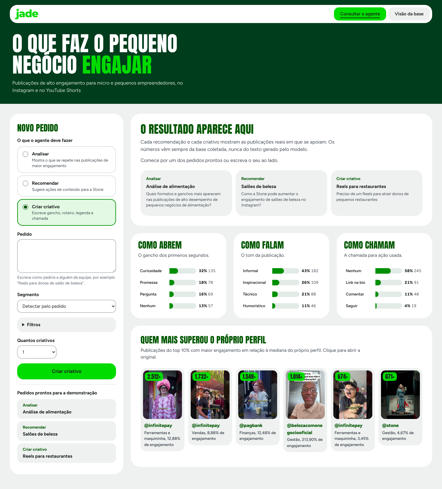

No modo criar criativo, cada peça mostra gancho, roteiro com marcação de tempo, legenda, chamada para ação e a justificativa. A coluna escura lista as publicações que inspiraram o criativo, com capa, perfil, engajamento e categorias, e o número de cada uma é o mesmo usado na lista de referências.

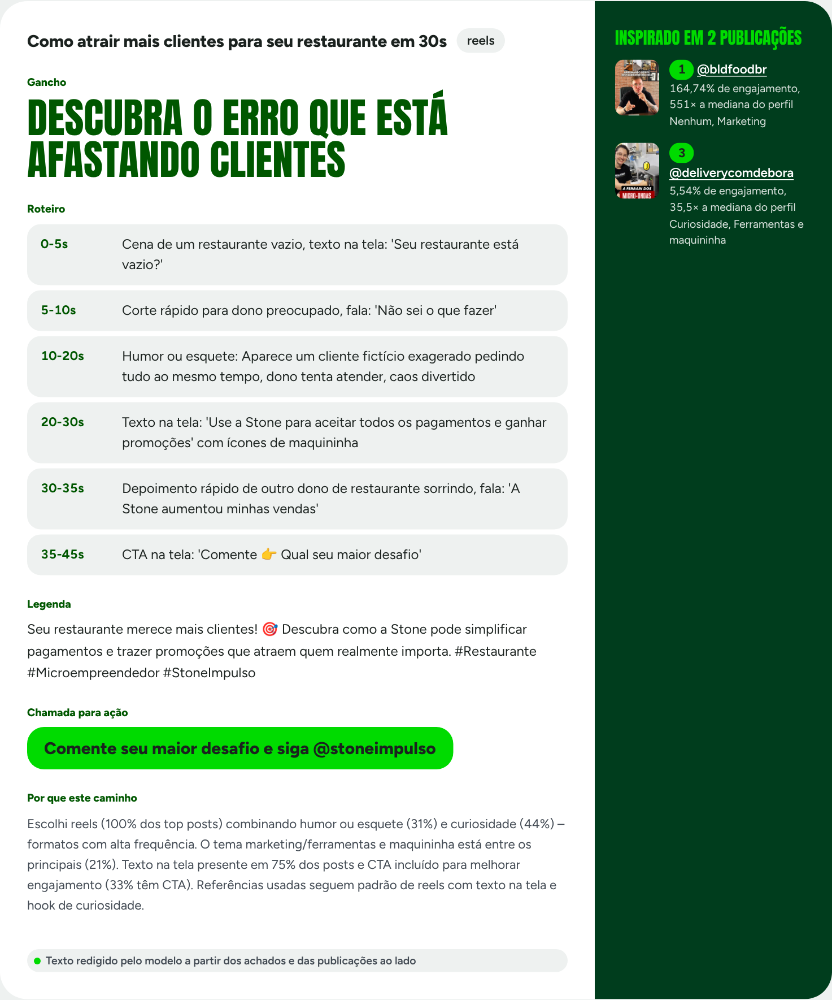

A lista de publicações de referência mostra os números da base para cada post (engajamento, vezes a mediana do perfil, curtidas, comentários e seguidores), as categorias da rubrica e o link para a publicação original. Clicar numa citação destaca a publicação correspondente.

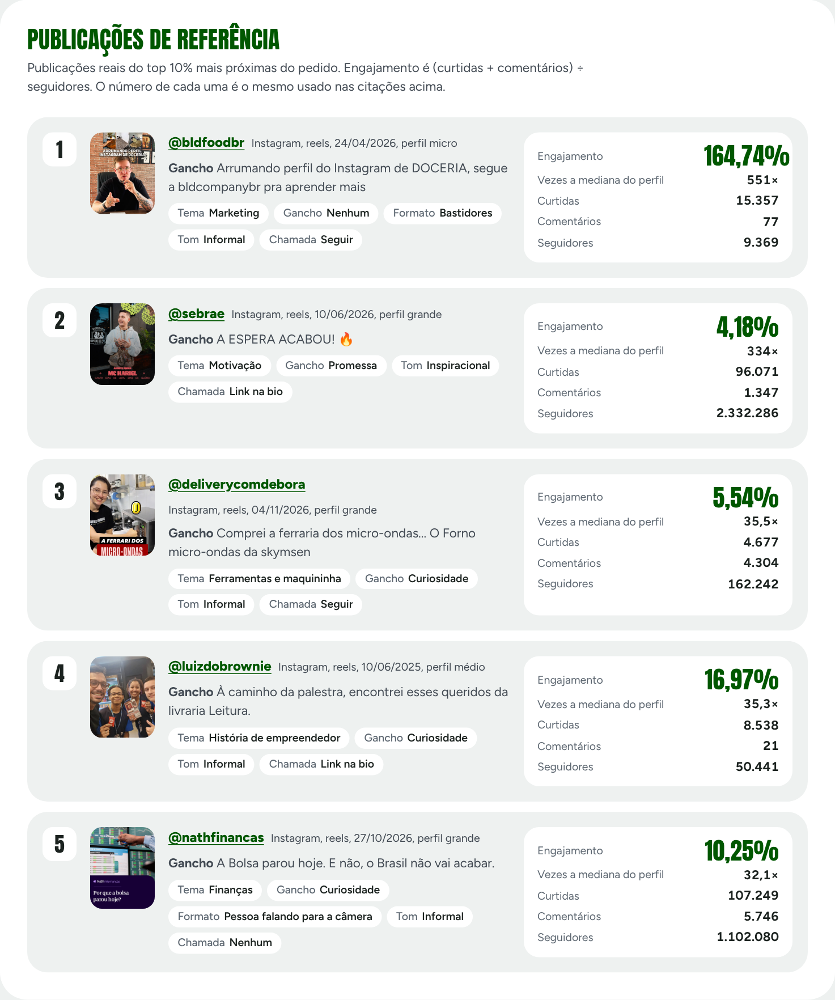

O gráfico de achados mostra as três categorias mais frequentes de cada campo da rubrica no recorte. Barras listradas indicam menos de 10 publicações. Clicar numa barra abre as publicações que ela conta.

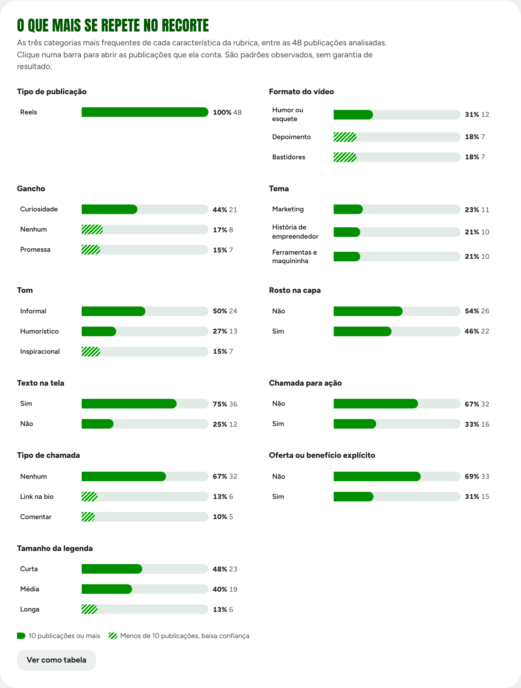

Nos modos recomendar e analisar, o texto do modelo aparece com um selo de origem, e os identificadores de publicação citados viram links para as referências.

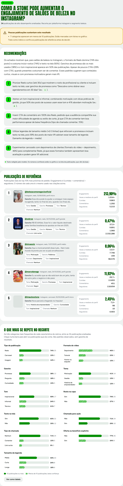

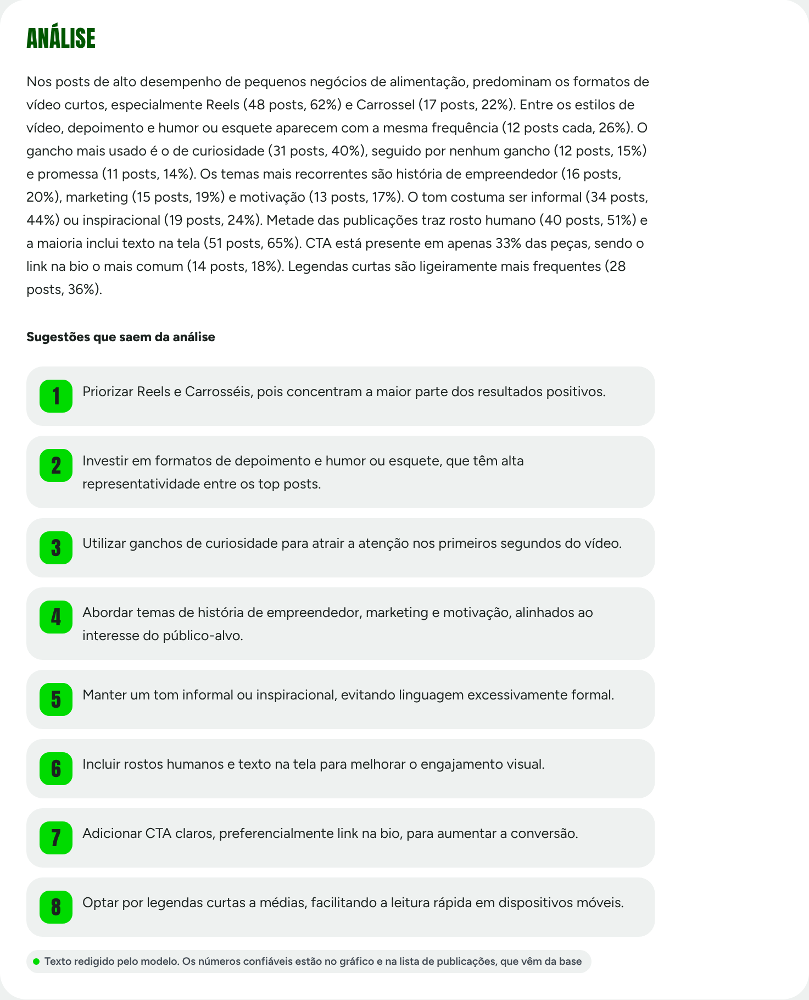

Os dois estados de erro previstos são a consulta sem resultado e o limite de requisições do modelo (HTTP 429).

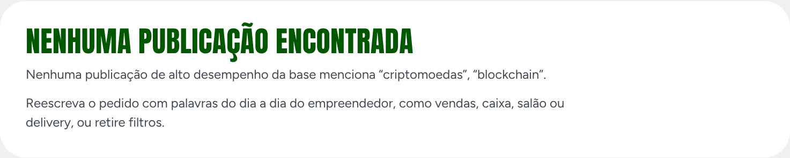

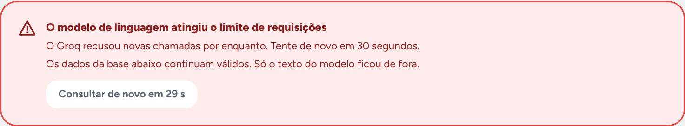

A aba Visão da base mostra os números gerais, os temas e formatos do top 10%, o ranking completo com filtro por plataforma e tema e os perfis em destaque.

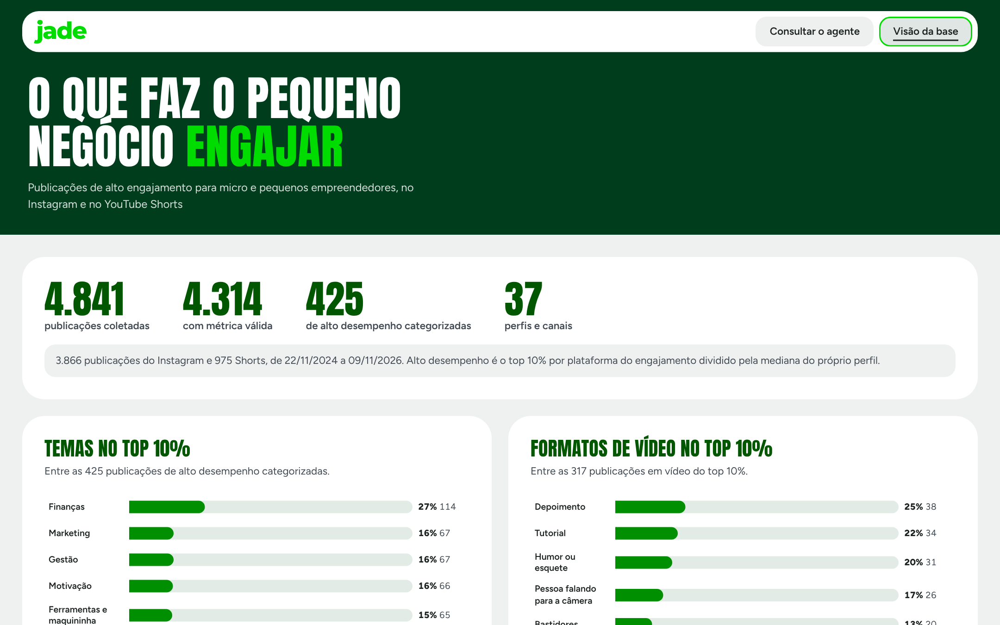

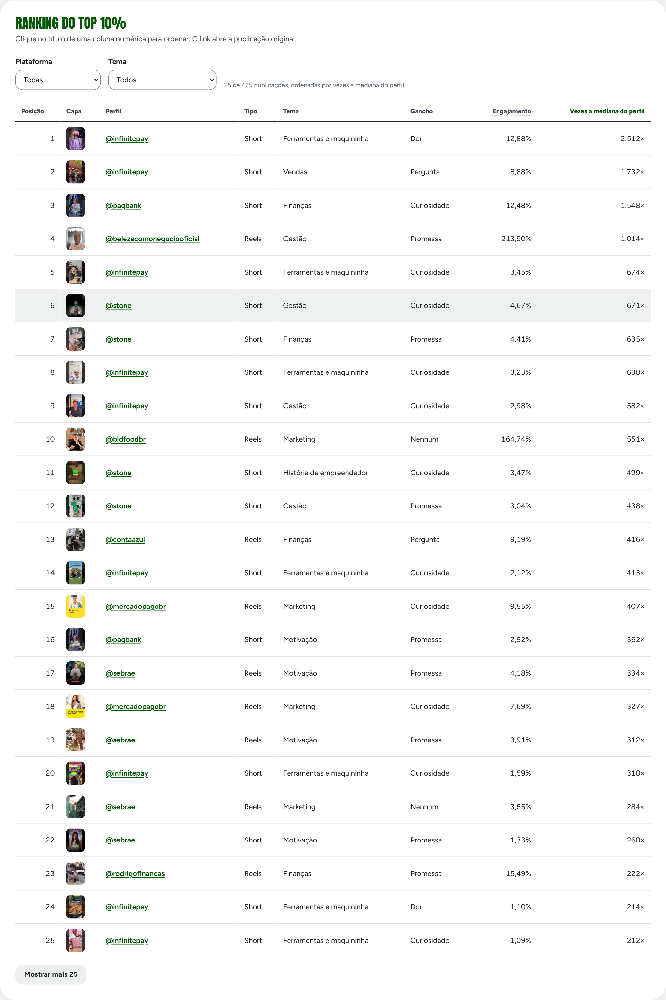

## 4. Base de dados

**Origem e rotas.** Só foram usadas rotas oficiais, sem scraping.

- **Instagram.** Endpoint Business Discovery da Instagram Graph API (Meta), versão `v27.0`, com app em modo de desenvolvimento e token de usuário (`coleta_instagram.py`). O Business Discovery só lê contas profissionais e devolve curtidas, comentários, legenda, tipo de mídia, data e link de cada post. Salvamentos e compartilhamentos não são fornecidos. Os limites de taxa (códigos 4, 17, 32 e 613) são tratados com espera de 60, 180, 300 e 600 segundos, e cada página baixada fica em cache em `data/raw/`.
- **YouTube.** YouTube Data API v3 (`coleta_youtube.py`). O canal é encontrado pelo `@handle` com `channels.list`, os vídeos vêm da playlist de uploads com `playlistItems.list` (1 unidade de cota por página, em vez das 100 da busca) e as estatísticas vêm de `videos.list`. Como a API não marca Shorts, o critério é duração de até 180 segundos. As respostas ficam em cache em `data/raw_youtube/`.

**Seleção de perfis.** A lista de candidatos (`candidatos.csv`) tem 62 contas do Instagram. O `validar_perfis.py` consulta cada uma e aprova só contas profissionais acessíveis com post nos últimos 12 meses. Para reduzir o viés de sobrevivência, limita as contas grandes a 15, mantendo `impulsostone`, `sebrae` e `nathfinancas` e, entre as demais, as de menos seguidores. Contas não oficiais e um banco generalista foram excluídos na curadoria manual. O resultado está em `perfis_validados.csv`.

| Situação dos candidatos do Instagram | Perfis |
|---|---|
| Aprovados | 31 |
| Excluídos por balanceamento de faixa (excesso de contas grandes) | 16 |
| Conta inexistente, pessoal ou inacessível | 10 |
| Excluídos na curadoria manual (contas não oficiais da Ton e da SumUp, banco generalista) | 4 |
| Sem posts nos últimos 12 meses | 1 |

Dos 31 aprovados, 15 são grandes, 10 médios e 6 micro, e por origem são 21 criadores MPE, 5 concorrentes, 4 do ecossistema Stone e 1 da curadoria do setor (`perfis_validados.csv`). No YouTube, 14 dos 20 canais de `canais_youtube.csv` foram encontrados pelo handle (`data/coleta_youtube_log.json`), e 13 deles têm Shorts na base. As faixas de tamanho são micro (menos de 10 mil seguidores ou inscritos), médio (de 10 mil a 100 mil) e grande (acima de 100 mil).

**Critérios das publicações.** Só entram posts com pelo menos 14 dias, para que curtidas e comentários estejam estabilizados. A janela foi de 730 dias no Instagram, para garantir volume em contas que publicam pouco, e de 365 dias no YouTube. A coleta do Instagram buscou até 300 posts por perfil e a do YouTube até 150 vídeos por canal.

| Item | Valor | Fonte |
|---|---|---|
| Data registrada da coleta | 23/11/2026 (Instagram e YouTube) | `data/coleta_log.json`, `data/coleta_youtube_log.json` |
| Posts do Instagram, brutos e válidos | 4.350 e 3.866 | `data/coleta_log.json` |
| Vídeos do YouTube, brutos e Shorts válidos | 1.993 e 975 | `data/coleta_youtube_log.json` |
| Publicações na base | 4.841 | `data/relatorio_base.md` |
| Publicações com métrica válida | 4.314 | `data/relatorio_base.md` |
| Período | 22/11/2024 a 09/11/2026 (YouTube a partir de 24/11/2025) | `data/relatorio_base.md`, `data/base.parquet` |
| Perfis e canais distintos | 37 | `data/relatorio_base.md` |

| Volume por plataforma e faixa | Publicações |
|---|---|
| Instagram grande | 2.247 |
| Instagram médio | 1.237 |
| Instagram micro | 382 |
| YouTube grande | 690 |
| YouTube médio | 268 |
| YouTube micro | 17 |

Fonte `data/relatorio_base.md`. Das 527 publicações sem métrica válida (10,9% da base), 402 são posts do Instagram com curtidas ocultas (`data/coleta_log.json`).

**Licença e uso.** Os dados são públicos e vêm de perfis profissionais, coletados pelas APIs oficiais dentro dos termos de cada plataforma. As imagens de capa baixadas para a categorização são de terceiros e ficam fora do git (`data/midia/`, listado em `.gitignore`), assim como as respostas brutas das APIs. A licença do código do repositório é [PREENCHER].

**Representatividade.** A base descreve o recorte escolhido e não o universo de conteúdo para MPEs. Só contas profissionais são acessíveis pela API, a faixa micro tem 6 perfis no Instagram e o YouTube micro tem só 17 publicações, abaixo do mínimo de 30 que `montar_base.py` usa para considerar um estrato confiável.

## 5. Métrica e critério de alto desempenho

**Taxa de engajamento normalizada.** Para cada publicação, calculada em `montar_base.py`.

```
engajamento = (curtidas + comentários) / seguidores
```

No YouTube, o denominador é o número de inscritos do canal. A divisão pelos seguidores é o que permite comparar uma conta com 9 mil seguidores e outra com 2 milhões, porque o número bruto de curtidas cresce com o tamanho da audiência. Publicações com curtidas ocultas ou sem seguidores ficam com a métrica inválida e não entram no ranking.

**Lift sobre o próprio perfil.** A normalização por seguidores não basta. Na primeira versão, o top 10% era calculado dentro de cada faixa de tamanho, e um único perfil (`nathfinancas`) ficou com 32% do topo porque a audiência dele engaja muito mais que a das outras contas grandes. Esse número está registrado no README da versão anterior, no histórico do git, e não há arquivo de saída com essa rodada. A versão final usa o lift.

```
lift = engajamento do post / mediana do engajamento do próprio perfil
```

O lift compara cada publicação com o desempenho normal da conta que a publicou e isola o efeito do conteúdo. Só entram perfis com pelo menos 10 publicações válidas, para que a mediana seja confiável.

**Corte do top 10%.** Alto desempenho é o top 10% de lift dentro de cada plataforma (`pct_lift >= 0,90`). O resultado são 430 publicações, 345 do Instagram e 85 do YouTube, e a maior participação de um único perfil caiu para 16,7% (`data/relatorio_base.md`). A marcação por estrato (plataforma e faixa) continua salva na base, na coluna `alto_estrato`, para comparação.

**Indicador de lead.** Métricas públicas não medem conversão. Como indicador indireto, `montar_base.py` marca a presença e o tipo de chamada para ação na legenda por expressões regulares (link na bio, comentar, salvar, mensagem direta, seguir, compartilhar), e a rubrica repete a marcação com o modelo.

## 6. Rubrica de categorização

A rubrica fixa do TAPI (seção 6.2) está em `rubrica.py` como modelo Pydantic. Cada resposta do modelo é validada contra ela, e uma resposta inválida volta para o modelo uma vez com os erros.

| Campo | Tipo e valores | Origem na versão final |
|---|---|---|
| `formato_video` | `talking_head`, `tutorial`, `bastidores`, `antes_depois`, `humor_esquete`, `depoimento`, `lista_dicas`, `trend` ou nulo (só Reels e Shorts) | legenda, Groq |
| `hook_primeiros_3s` | texto do gancho, até 15 palavras | legenda, Groq |
| `tipo_hook` | `pergunta`, `promessa`, `dor`, `numero`, `polemica`, `curiosidade`, `nenhum` | legenda, Groq |
| `forca_hook_0a10` | inteiro de 0 a 10 | legenda, Groq |
| `tema_principal` | `vendas`, `financas`, `marketing`, `atendimento`, `gestao`, `motivacao`, `ferramentas_maquininha`, `historia_de_empreendedor` | legenda, Groq |
| `tem_rosto` | booleano | imagem, detector Haar do OpenCV |
| `criador_e_empreendedor_real` | booleano | legenda, Groq |
| `prova_social` | booleano | legenda, Groq |
| `texto_na_tela` | booleano | imagem, modelo de visão local |
| `ritmo_cortes_0a10` | sempre nulo (Nível 2) | não observável pela capa |
| `tom` | `informal`, `tecnico`, `inspiracional`, `humoristico` | legenda, Groq |
| `usa_linguagem_regional` | booleano | legenda, Groq |
| `clareza_mensagem_0a10` | inteiro de 0 a 10 | legenda, Groq |
| `tem_cta` | booleano | legenda, Groq |
| `tipo_cta` | `comentar`, `salvar`, `link_na_bio`, `dm`, `seguir`, `compartilhar`, `nenhum` | legenda, Groq |
| `oferta_ou_beneficio_explicito` | booleano | legenda, Groq |
| `elementos_top5` | lista de até 5 textos curtos | legenda, Groq |
| `legenda_tamanho`, `duracao_faixa`, `tipo_post` | calculados sem modelo | `categorizar.py`, `montar_base.py` |

**Modelos testados.** A categorização passou por três versões, todas registradas no repositório.

1. **Groq com imagem.** `categorizar.py` com `qwen/qwen3.8-27b`, legenda e capa. O plano gratuito comportou cerca de 50 publicações por dia, porque cada imagem consome muitos tokens (registro no cabeçalho de `categorizar.py`).
2. **Modelo de visão local.** `categorizar.py --provedor ollama` com `qwen3-vl:2b-instruct` no Ollama. As respostas colapsaram para quase o mesmo valor em todos os posts, com 100% de `talking_head`, 100% de empreendedor real, 97,2% com chamada para ação e notas médias de 9,89 para o gancho e 9,75 para a clareza. Essa rodada está guardada em `data/categorias_vlm.parquet`.
3. **Versão híbrida por fonte (final).** `categorizar_texto.py`. Os campos de texto vêm do `qwen/qwen3.8-27b` lendo só a legenda, em lotes de 10 publicações, com temperatura 0 e legenda limitada a 500 caracteres. O rosto vem do detector Haar do OpenCV (`modelos/haarcascade_frontalface_default.xml`), que é determinístico. O texto na tela vem do modelo de visão local, o único campo visual dele com distribuição plausível. O resultado está em `data/categorias.parquet`, com 425 das 430 publicações do top 10%, e o campo `modelo` registra a combinação usada.

**Validação manual.** `validacao.py amostra` sorteou 50 publicações do top 10%, estratificadas por plataforma e tipo de post (semente 42). A anotação foi feita às cegas, sem ver a resposta do modelo, com a ferramenta `anotar.py`, que gera uma página local com a capa, a legenda e as listas de opções. Entraram 49 publicações, porque uma da amostra não tem categorização. `validacao.py avaliar` calcula a concordância e o kappa de Cohen por campo e grava `data/validacao_resultado.md`.

| Campo | Publicações | Concordância | Kappa | Leitura |
|---|---|---|---|---|
| `tem_rosto` | 49 | 82% | 0,60 | substancial |
| `texto_na_tela` | 49 | 65% | 0,22 | fraca |
| `tem_cta` | 49 | 57% | 0,07 | fraca |

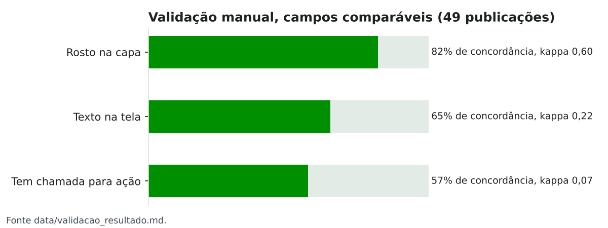

Os campos `tipo_hook`, `tema_principal`, `tom` e `tipo_cta` aparecem em `data/validacao_resultado.md` com concordância de 0% a 10%, mas não são comparáveis, porque a anotação usou categorias livres em vez dos valores da rubrica (por exemplo "reforma tributária" como gancho). Essa anotação mostra uma lacuna da rubrica, já que notícias (reforma tributária, limite do MEI) e propaganda de produto aparecem com frequência no topo e não têm categoria própria. O `formato_video` aparece com 100% em 25 publicações porque a anotação deixou o campo em branco e o cálculo conta como concordância os carrosséis e imagens, em que o campo é nulo dos dois lados. Na prática, o formato de vídeo não foi validado. Nas divergências de chamada para ação, a anotação humana considerou pedidos como "baixe o app" e "inscreva-se", que a rubrica não cobre bem.

## 7. Arquitetura

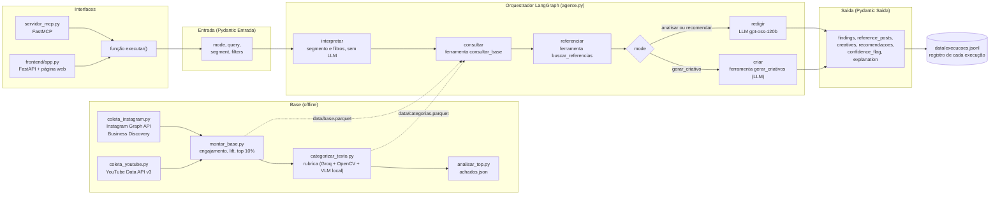

O mesmo diagrama está em [`arquitetura/arquitetura.mmd`](arquitetura/arquitetura.mmd).

O sistema tem três camadas. A **base** é montada fora do agente, por scripts que rodam uma vez e gravam arquivos em `data/`. O **agente** (`agente.py`) é um `StateGraph` do LangGraph que lê esses arquivos. As **interfaces** (função Python, servidor MCP e frontend) chamam a mesma função `executar()`.

O grafo tem cinco nós e uma aresta condicional.

- **interpretar** extrai do pedido o segmento (por palavras-chave como restaurante, salão, loja, MEI), a plataforma, o tipo de post e a faixa, sem modelo de linguagem. Filtros informados na entrada têm prioridade.
- **consultar** chama a ferramenta `consultar_base`, que filtra o top 10% categorizado e calcula a frequência das três categorias mais comuns de cada campo da rubrica. Se sobrarem menos de 15 publicações, os filtros são retirados do mais específico para o mais geral (faixa, tema, tipo de post, plataforma e por fim segmento). Para o tipo de post, calcula também a razão entre a frequência no top e na base.
- **referenciar** chama a ferramenta `buscar_referencias`, que ordena as publicações do recorte por palavras em comum com o pedido ponderadas pelo logaritmo do lift e devolve até 5 publicações, de perfis diferentes quando o recorte permite (3 no modo analisar).
- **redigir** (modos analisar e recomendar) pede ao modelo uma análise ou de 3 a 5 recomendações com base só nos achados e nas referências recebidos. Se o modelo falhar, a explicação é montada direto dos achados, sem modelo.
- **criar** (modo gerar_criativo) chama a ferramenta `gerar_criativos`, que pede ao modelo gancho, roteiro, legenda, chamada e justificativa. Cada criativo é validado com Pydantic, e os identificadores de inspiração que não estão entre as referências são descartados.

Ao final, `executar()` calcula o `confidence_flag`, monta a `Saida` e grava a execução em `data/execucoes.jsonl`, com data, duração, modelo, entrada, erros e saída.

O frontend (`frontend/app.py`) é uma API FastAPI fina sobre `executar()`. Ela acrescenta só dados lidos da base (curtidas, comentários, seguidores, capa e exemplos de cada achado), verifica antes da chamada se o pedido tem alguma palavra presente no top 10% e troca a espera do Groq por uma resposta HTTP 429 imediata quando o limite é atingido. A página é HTML, CSS e JavaScript sem etapa de build.

## 8. Contrato da ferramenta

A entrada e a saída são modelos Pydantic em `agente.py`.

**Entrada (`Entrada`)**

| Campo | Tipo | Descrição |
|---|---|---|
| `mode` | `analisar`, `recomendar` ou `gerar_criativo` | o que o agente deve fazer |
| `query` | texto | pergunta ou objetivo em linguagem natural |
| `segment` | texto opcional | `alimentacao`, `beleza`, `varejo`, `financas`, `gestao`, `marketing` (detectado pelo pedido quando vazio) |
| `filters` | `Filtros` | `plataforma` (`instagram`, `youtube`), `tipo_post` (`reels`, `carrossel`, `imagem`, `short`, `video`), `faixa` (`micro`, `medio`, `grande`) e `tema_principal`, todos opcionais |
| `n_criativos` | inteiro de 1 a 5 | quantidade de criativos no modo gerar_criativo |

O contrato não tem filtro de período. A janela de datas é definida na coleta.

**Saída (`Saida`)**

| Campo | Descrição |
|---|---|
| `filtros_aplicados`, `n_posts_analisados` | recorte efetivamente usado e quantas publicações do top 10% ele tem |
| `findings` | lista de `Achado` com campo, valor, número de publicações, percentual, razão top/base (só tipo de post) e `confidence_flag` próprio |
| `reference_posts` | lista de `PostReferencia` com id, perfil, plataforma, tipo, link, engajamento, lift, tema, tipo de gancho, formato e gancho |
| `creatives` | lista de `Criativo` com título, formato, gancho, roteiro (lista de cenas com tempo e ação), legenda, chamada, `inspirado_em` e justificativa |
| `recomendacoes` | lista de textos (modos analisar e recomendar) |
| `confidence_flag` | verdadeiro quando o recorte tem menos de 15 publicações, quando algum filtro foi retirado ou quando gancho, tema ou formato se apoiam em menos de 10 publicações |
| `explanation` | justificativa em linguagem natural |

**Exemplo real.** Execução registrada em `data/execucoes.jsonl` em 24/11/2026 às 23:33:47 UTC, com o modelo `openai/gpt-oss-120b`. A saída abaixo foi encurtada nas listas, indicadas com `...`.

```json
{
  "mode": "gerar_criativo",
  "query": "Preciso de um Reels para atrair donos de pequenos restaurantes",
  "segment": "alimentacao",
  "filters": {"plataforma": null, "tipo_post": "reels", "faixa": null, "tema_principal": null},
  "n_criativos": 1
}
```

```json
{
  "filtros_aplicados": {"faixa": null, "tema_principal": null, "tipo_post": "reels",
                        "plataforma": null, "segmento": "alimentacao"},
  "n_posts_analisados": 48,
  "findings": [
    {"campo": "tipo_post", "valor": "reels", "posts": 48, "pct": 1.0, "razao_top_base": 1.99, "confidence_flag": false},
    {"campo": "formato_video", "valor": "humor_esquete", "posts": 12, "pct": 0.308, "razao_top_base": null, "confidence_flag": false},
    {"campo": "formato_video", "valor": "depoimento", "posts": 7, "pct": 0.179, "razao_top_base": null, "confidence_flag": true},
    "..."
  ],
  "reference_posts": [
    {"post_id": "ig_18060261665702121", "perfil": "bldfoodbr", "plataforma": "instagram", "tipo_post": "reels",
     "url": "https://www.instagram.com/reel/DXiEpzBDckO/", "engajamento": 1.64735, "lift": 551.21,
     "tema_principal": "marketing", "tipo_hook": "nenhum", "formato_video": "bastidores",
     "gancho": "Arrumando perfil do Instagram de DOCERIA, segue a bldcompanybr pra aprender mais"},
    "..."
  ],
  "creatives": [
    {"titulo": "Como atrair mais clientes para seu restaurante em 30s",
     "formato": "reels",
     "gancho": "Descubra o erro que está afastando clientes",
     "roteiro": [{"tempo": "0-5s", "acao": "Cena de um restaurante vazio, texto na tela: 'Seu restaurante está vazio?'"}, "..."],
     "legenda": "Seu restaurante merece mais clientes! ...",
     "cta": "Comente seu maior desafio e siga @stoneimpulso",
     "inspirado_em": ["ig_18060261665702121", "ig_18134765962802326"],
     "justificativa": "Escolhi reels (100% dos top posts) combinando humor_esquete (31%) e curiosidade (44%) ..."}
  ],
  "recomendacoes": [],
  "confidence_flag": true,
  "explanation": "Entre 48 publicações de alto desempenho (...), tipo_post mais frequente = reels (100%); ..."
}
```

Nesse exemplo, o `confidence_flag` é verdadeiro porque `depoimento` e `bastidores` aparecem em 7 publicações cada. Os textos do criativo foram redigidos pelo modelo e os demais campos vêm da base.

## 9. Modelos e configurações

| Etapa | Modelo e versão | Parâmetros | Onde |
|---|---|---|---|
| Categorização final, campos de texto | `qwen/qwen3.8-27b` no Groq | temperatura 0, saída JSON, `reasoning_effort` none, até 2.500 tokens, lotes de 10, legenda até 500 caracteres | `categorizar_texto.py` |
| Categorização com imagem (primeira tentativa) | `qwen/qwen3.8-27b` no Groq | temperatura 0, saída JSON, até 500 tokens, imagem com lado máximo de 768 px | `categorizar.py` |
| Texto na tela | `qwen3-vl:2b-instruct` no Ollama, local | temperatura 0, saída estruturada pelo esquema da rubrica | `categorizar.py --provedor ollama` |
| Rosto na capa | detector Haar `haarcascade_frontalface_default.xml`, OpenCV abaixo da versão 5 | imagem reduzida para 640 px, `scaleFactor` 1,1, `minNeighbors` 5 | `categorizar_texto.py` |
| Agente | `openai/gpt-oss-120b` no Groq | temperatura 0,4, saída JSON, `reasoning_effort` low, até 2.500 tokens no criativo e 1.800 na análise | `agente.py` |

**Limites gratuitos.** O plano gratuito do Groq limita requisições e tokens por modelo. O cabeçalho de `categorizar.py` registra que a categorização com imagem comportou cerca de 50 publicações por dia. Os limites numéricos do `openai/gpt-oss-120b` no plano usado são [PREENCHER]. A YouTube Data API v3 tem cota diária por chave, e a leitura pela playlist de uploads custa 1 unidade por página em vez das 100 da busca. Os limites de taxa da Instagram Graph API em modo de desenvolvimento são [PREENCHER].

**Tratamento do erro 429.**

- Coleta do Instagram. Espera de 60, 180, 300 e 600 segundos e, se o limite persistir, segue só com as páginas já em cache e registra onde parou em `data/coleta_log.json`.
- Categorização. Respeita o cabeçalho `retry-after` do Groq em até 10 tentativas e para quando a espera passa de 600 segundos, sinal de limite diário. As respostas já obtidas ficam em `data/categorias_texto.jsonl`, então a execução continua de onde parou.
- Agente. Respeita o `retry-after` em até 6 tentativas e desiste quando a espera passa de 300 segundos. Se o modelo falhar no modo analisar ou recomendar, a explicação é montada direto da base.
- Frontend. Espera no máximo uma vez, por até 8 segundos, e depois responde HTTP 429 com o tempo de espera e os dados da base, para a tela não ficar parada durante a apresentação.

**Alternativa local.** A categorização roda inteira no Ollama com `--provedor ollama`, sem limite de uso, e aceita `--max-lado 448` para acelerar em CPU e `--parte 1/2` para dividir o trabalho em dois terminais. O agente não tem modelo local configurado. Sem o Groq, ele continua devolvendo achados, referências e a explicação montada da base, sem recomendações nem criativos.

## 10. Decisões técnicas

**LangGraph como orquestrador.** O TAPI pede um agente com ferramentas e estado. O `StateGraph` deixa o fluxo explícito no código (interpretar, consultar, referenciar e redigir ou criar), com uma aresta condicional pelo modo. A alternativa de uma cadeia única de prompts esconderia as etapas e misturaria cálculo com redação. O custo é que um novo modo exige um nó e uma aresta em `montar_grafo()`.

**Modelo de linguagem só para interpretar e redigir.** Os números da base precisam ser verificáveis na apresentação. Frequências, filtros, ranking e escolha das referências são feitos em pandas, e o modelo recebe esses resultados prontos. A consequência é que a qualidade das referências depende de uma busca simples por palavras, e não de busca semântica.

**Pydantic no contrato e na rubrica.** A rubrica tem valores fechados, e o contrato é consumido por três interfaces. Validar com Pydantic garante que a categorização só grava valores da rubrica e que o frontend, o MCP e a função recebem o mesmo formato. Respostas fora do esquema voltam ao modelo com os erros.

**Lift em vez de percentil por faixa.** O percentil por faixa deixou um perfil com 32% do topo. O lift mede quanto cada post supera a própria conta, o que reduz a dominância de perfis com audiência muito engajada (16,7% na versão final). A contrapartida é que perfis com menos de 10 publicações válidas ficam fora do ranking.

**Categorização híbrida por fonte.** A rodada só com imagem no Groq não cabia no plano gratuito e a rodada local com o modelo de 2B colapsou. Cada campo passou a vir da fonte mais confiável para ele, que é a legenda para os campos de texto, um detector determinístico para o rosto e o modelo local para o texto na tela. O preço é que o formato de vídeo é inferido do texto, sem ver o vídeo.

**Rotas oficiais de coleta com cache.** Business Discovery e YouTube Data API são as rotas permitidas e reproduzíveis. Cada resposta fica em `data/raw/` e `data/raw_youtube/`, o que permite reconstruir a base sem gastar cota (`--somente-cache` no Instagram). O limite é que só contas profissionais ficam acessíveis.

**FastMCP para integração.** O servidor MCP expõe a mesma função a clientes externos com poucas linhas, sem duplicar lógica.

**Frontend sem build.** A demonstração precisa subir com um comando no computador da apresentação. FastAPI serve a API e uma página em HTML, CSS e JavaScript sem dependências de npm, com fontes salvas no próprio repositório. A alternativa em Streamlit ou Gradio foi descartada porque dificultaria a rastreabilidade com links e destaques entre criativo e referência.

## 11. Metodologia

Cada passo grava arquivos em `data/` que o passo seguinte lê, e as respostas das APIs e dos modelos ficam em cache.

| Passo | Comando | Saída |
|---|---|---|
| 1. Validar perfis | `python validar_perfis.py --entrada candidatos.csv` | `perfis_validados.csv`, `perfis.csv` |
| 2. Coletar Instagram | `python coleta_instagram.py --perfis perfis.csv --max-posts 300 --janela-dias 730` | `data/posts.parquet`, `data/perfis.parquet`, `data/coleta_log.json` |
| 3. Coletar YouTube | `python coleta_youtube.py --canais canais_youtube.csv --max-videos 150` | `data/youtube_posts.parquet`, `data/youtube_canais.parquet`, `data/coleta_youtube_log.json` |
| 4. Montar base e ranking | `python montar_base.py` | `data/base.parquet`, `data/base.csv`, `data/top10.csv`, `data/midia/`, `data/relatorio_base.md` |
| 5. Categorizar | `python categorizar.py --provedor ollama` e depois `python categorizar_texto.py` | `data/categorias_vlm.parquet`, `data/categorias_texto.jsonl`, `data/categorias.parquet` |
| 6. Validar | `python validacao.py amostra`, `python anotar.py gerar`, anotação, `python anotar.py importar <csv>`, `python validacao.py avaliar` | `data/validacao_manual.xlsx`, `data/validacao_resultado.md` |
| 7. Gerar achados | `python analisar_top.py` | `data/achados.md`, `data/achados.json` |
| 8. Demonstrar | `python demo.py`, `python gerar_playbook.py` | `data/demo.md`, `data/playbook.md`, `data/playbook_criativos.json` |
| 9. Usar | `.\.venv\Scripts\python.exe frontend\app.py` ou `python servidor_mcp.py` | `data/execucoes.jsonl` |

Para reproduzir sem chamar as APIs de coleta, basta manter `data/raw/` e `data/raw_youtube/` e rodar `coleta_instagram.py --somente-cache` e `coleta_youtube.py`, que leem o cache antes de qualquer requisição.

## 12. Resultados

Os números abaixo descrevem as 425 publicações de alto desempenho categorizadas (`data/achados.json` e `data/achados.md`). São padrões observados no topo, sem comparação com o restante da base, e não garantem engajamento.

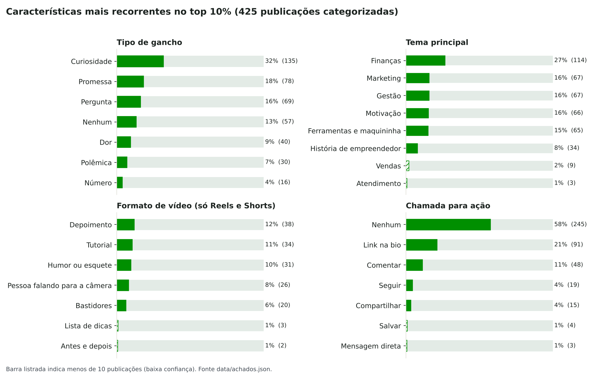

**Características mais recorrentes.**

| Campo | Mais frequentes no top 10% |
|---|---|
| Tipo de gancho | curiosidade 32% (135), promessa 18% (78), pergunta 16% (69), nenhum 13% (57), dor 9% (40) |
| Tema | finanças 27% (114), marketing 16% (67), gestão 16% (67), motivação 16% (66), ferramentas e maquininha 15% (65) |
| Formato de vídeo (Reels e Shorts) | depoimento 12% (38), tutorial 11% (34), humor ou esquete 10% (31), pessoa falando para a câmera 8% (26), bastidores 6% (20) |
| Tom | informal 43% (182), inspiracional 26% (109), técnico 21% (88), humorístico 11% (46) |
| Chamada para ação | nenhuma 58% (245), link na bio 21% (91), comentar 11% (48) |
| Rosto na capa | 60% (257) |
| Texto na tela | 63% (267) |
| Oferta ou benefício explícito | 39% (164) |
| Prova social | 9% (39) |
| Empreendedor real contando a própria experiência | 17% (73) |

As notas médias atribuídas pelo modelo foram 5,9 para a força do gancho e 7,3 para a clareza da mensagem. Os temas vendas (9 publicações) e atendimento (3) e os formatos lista de dicas (3) e antes e depois (2) aparecem com o aviso de baixa confiança.

**Tipo de publicação.** Reels aparecem um pouco mais no topo do que na base (razão 1,10) e imagem estática bem menos (razão 0,60). Fonte `data/relatorio_base.md`.

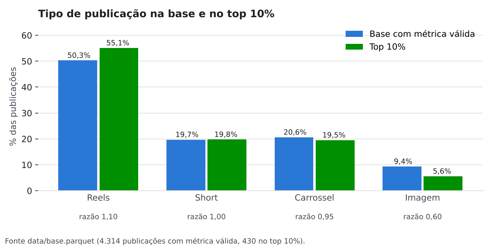

**Recortes por tema e formato.** Fonte `data/achados.md`.

- Finanças aparece mais em pessoa falando para a câmera (16) e tutorial (14).
- História de empreendedor aparece mais em depoimento (13).
- Marketing aparece mais em bastidores (9).
- Ferramentas e maquininha se distribui entre humor ou esquete (9), depoimento (8) e tutorial (8).
- Motivação aparece em depoimento (8) e humor ou esquete (8).
- Curiosidade é o gancho mais comum nas duas plataformas (112 no Instagram e 23 no YouTube). Polêmica aparece quase só no Instagram (28 contra 2).

**Comparação entre base e topo (`data/relatorio_base.md`).** Perfis grandes somam 60,5% da base e 70,7% do topo, médios caem de 30,2% para 19,1% e micro sobem de 9,2% para 10,2%. A presença de chamada para ação detectada por regra é de 30,4% na base e 27,0% no topo. Por origem, o topo tem 186 publicações de criadores MPE, 131 de concorrentes, 70 do ecossistema Stone, 41 da curadoria do setor e 2 de plataformas para MPE.

**Perfis em destaque.** Perfis com mais publicações no top 10% categorizado (`data/achados.md`).

| Perfil | Plataforma | Faixa | Posts no topo | Tema predominante | Formato predominante | Lift mediano |
|---|---|---|---|---|---|---|
| nathfinancas | Instagram | grande | 56 | finanças | pessoa falando para a câmera | 9,47 |
| sebrae | Instagram | grande | 35 | marketing | bastidores | 12,13 |
| infinitepay | Instagram | grande | 31 | ferramentas e maquininha | humor ou esquete | 11,21 |
| rodrigofinancas | Instagram | grande | 30 | gestão | reels | 10,88 |
| contaazul | Instagram | grande | 28 | gestão | pessoa falando para a câmera | 8,89 |
| mercadopagobr | Instagram | grande | 25 | finanças | humor ou esquete | 19,92 |
| infinitepay | YouTube | grande | 24 | ferramentas e maquininha | depoimento | 58,58 |
| luizdobrownie | Instagram | médio | 17 | história de empreendedor | humor ou esquete | 14,79 |
| facoascontas | Instagram | médio | 16 | finanças | tutorial | 8,15 |
| stone | YouTube | médio | 14 | história de empreendedor | depoimento | 17,25 |
| bldfoodbr | Instagram | micro | 12 | marketing | bastidores | 7,07 |
| belezacomonegociooficial | Instagram | micro | 11 | ferramentas e maquininha | tutorial | 16,55 |

**Exemplos reais.** A publicação de maior lift em cada categoria frequente está em `data/achados.json`. Alguns casos são um Short da PagBank com gancho de curiosidade, tema finanças e formato depoimento ([link](https://www.youtube.com/shorts/gekE1L2ENQw), lift 1.547,54), um Reels da @belezacomonegociooficial com gancho de promessa e tema gestão ([link](https://www.instagram.com/reel/DdMYU6ER815/), lift 1.014,09) e um Short da InfinitePay com gancho de pergunta em formato tutorial ([link](https://www.youtube.com/shorts/Efv_beC-m5A), lift 1.732,08).

**Saídas do agente.** `data/demo.md` tem um pedido de cada modo e `data/playbook.md` tem recomendações e cinco criativos (alimentação, beleza, varejo e moda, finanças do MEI e gestão), cada um com as publicações que o inspiraram.

## 13. Rastreabilidade

Cada recomendação e cada criativo se liga a publicações reais por quatro mecanismos.

1. **Referências escolhidas pela base.** `buscar_referencias` seleciona as publicações em pandas, antes da chamada ao modelo. O modelo recebe a lista com os identificadores e não consegue acrescentar publicações.
2. **Validação dos identificadores.** Em `gerar_criativos`, o campo `inspirado_em` é filtrado contra os identificadores recebidos. Um identificador inventado é descartado, e se nenhum sobrar o criativo passa a apontar para a primeira referência.
3. **Números fora do texto do modelo.** O frontend mostra engajamento, lift, curtidas, comentários, seguidores e frequências a partir dos campos da base. O texto do modelo aparece com um selo de origem e sem destaque numérico.
4. **Links na tela.** Cada referência tem link para a publicação original. Nos textos do modelo, todo identificador citado vira um link numerado para a referência correspondente, um link para o post quando ele está na base fora das referências ou um aviso quando não está na base. Cada barra do gráfico de achados abre as três publicações de maior lift que ela conta, no mesmo recorte usado pelo agente.

Cada execução fica em `data/execucoes.jsonl` com entrada, saída, modelo e erros, o que permite reconstruir de onde saiu cada criativo apresentado.

## 14. Testes

O repositório não tem uma suíte automatizada. A verificação foi feita em quatro frentes.

**Validação da categorização.** Amostra de 49 publicações anotadas às cegas, com concordância e kappa por campo (seção 6 e `data/validacao_resultado.md`).

**Validação dos dados.** `montar_base.py` registra em `data/relatorio_base.md` os estratos com menos de 30 publicações e a participação máxima de um perfil no topo, e as coletas registram volumes e falhas em `data/coleta_log.json` e `data/coleta_youtube_log.json`. O download das capas do top 10% teve as 430 publicações com status ok (coluna `midia_status` de `data/base.parquet`).

**Execuções de ponta a ponta.** `data/execucoes.jsonl` registra 21 execuções do agente (3 de análise, 4 de recomendação e 14 de criativo) com a base real. Duas delas registram o erro de limite, geradas de propósito com `SIMULAR_LIMITE=1` para testar a tela de erro. Uma execução de criativo de `demo.py` terminou sem criativo e sem erro registrado. O código descarta sem registrar erro os criativos que não passam na validação do Pydantic, o que deixa esse caso sem diagnóstico no log.

**Frontend.** Os três pedidos prontos foram executados pela interface com a base real. Também foram testados o pedido vazio (HTTP 400), a consulta sem resultado (HTTP 404, por exemplo "criptomoedas e blockchain") e o limite do modelo (HTTP 429 com `SIMULAR_LIMITE=1`). As telas da seção 3 foram capturadas a partir de execuções gravadas em `data/execucoes.jsonl`.

## 15. Limitações, vieses e riscos

**Viés de sobrevivência.** A análise olha só o que deu certo. As características do top 10% não foram comparadas com as do restante da base (extensão opcional do TAPI), então uma característica comum no topo pode ser só comum no nicho. O balanceamento de contas grandes e a inclusão de perfis micro reduzem o problema, mas a faixa micro continua pequena.

**Padrões não garantem resultado.** As frequências descrevem o que aparece no topo. Elas não medem causa e não preveem o desempenho de uma publicação nova.

**Engajamento não é conversão.** Curtidas e comentários públicos não medem leads nem vendas. Salvamentos, compartilhamentos e alcance não estão disponíveis pelo Business Discovery, e 10,9% da base ficou sem métrica por curtidas ocultas.

**Representatividade.** Só contas profissionais são acessíveis pela API. A faixa micro tem 6 perfis no Instagram e o YouTube micro tem 17 publicações. A janela do YouTube é de 12 meses e a do Instagram de 24.

**Categorização.** O formato de vídeo é inferido da legenda, sem assistir ao vídeo. Texto na tela e chamada para ação tiveram concordância fraca na validação, e gancho, tema, tom e tipo de chamada não foram validados com os valores da rubrica. A rubrica não tem categorias para notícias e propaganda de produto, que aparecem com frequência no topo.

**Agente.** A busca de referências usa palavras em comum, então pedidos com sinônimos que não aparecem nas legendas podem trazer referências menos próximas. O texto do modelo pode citar percentuais na justificativa, e esses números precisam ser conferidos nos achados exibidos ao lado. O tom do criativo segue as instruções do Impulso Stone escritas no prompt e não foi avaliado por pessoas da Stone.

**Dependência de serviços gratuitos.** Modelos e limites do Groq podem mudar. Os identificadores dos modelos ficam registrados em cada saída (`modelo` em `data/categorias.parquet` e `modelo_llm` em `data/execucoes.jsonl`).

**Imagens de terceiros.** As capas das publicações são de terceiros e não fazem parte do repositório. As capturas de tela em `docs/img/` mostram capas em miniatura.

## 16. Possibilidades de evolução

- Comparar as características do top 10% com o restante da base, para separar o que diferencia o topo do que é só comum no nicho.
- Ampliar a rubrica com categorias de notícia e propaganda e com chamadas para baixar app ou se inscrever, e refazer a validação com os valores da rubrica e mais de um anotador.
- Nível 2 do TAPI, com frames e transcrição dos vídeos (por exemplo faster-whisper ou Whisper no Groq), para validar o formato de vídeo e medir o ritmo de cortes.
- Busca semântica sobre as publicações de alto desempenho e análise de intenção nos comentários.
- Usar os Insights do Instagram da própria Stone para medir alcance, salvamentos e conversão.
- Criar uma suíte de testes offline para o contrato, os filtros, o cálculo do lift e a validação dos identificadores de inspiração.
- Configurar um modelo local também para o agente, para a demonstração não depender do plano gratuito.
